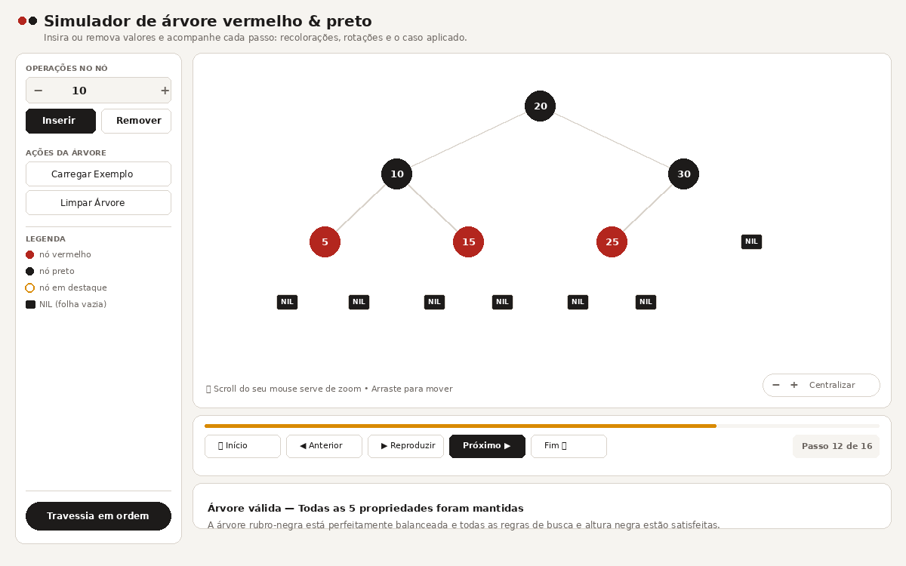
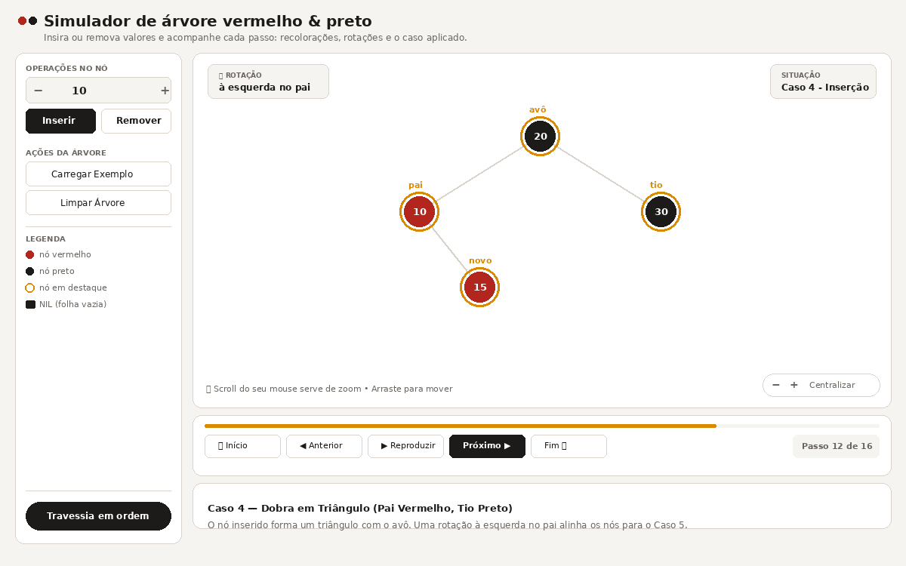
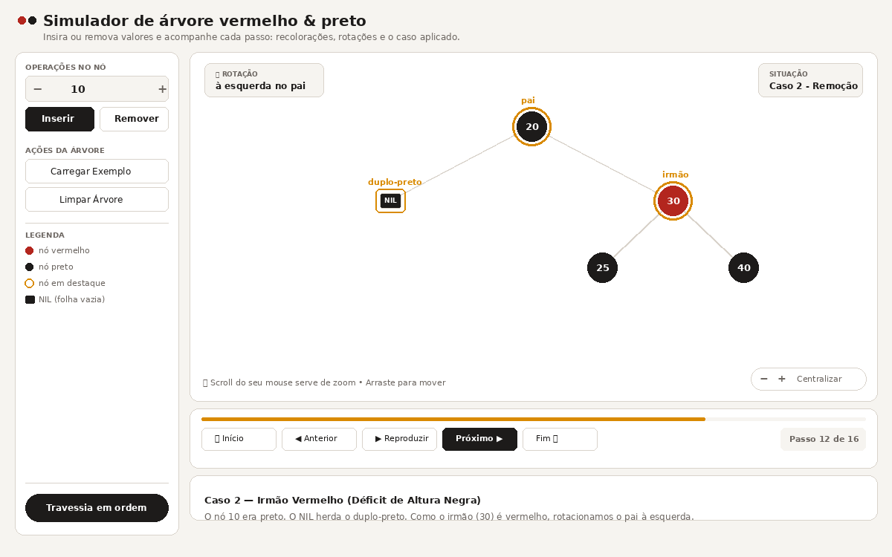
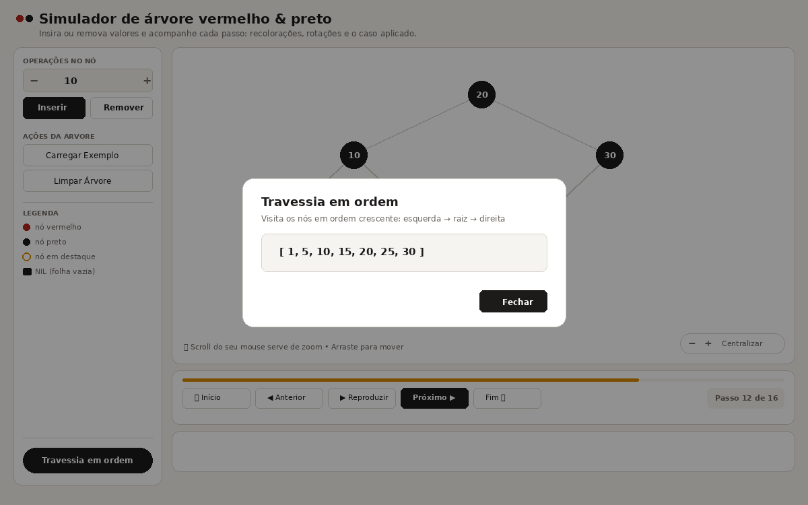

# G15_Arvores_EDA2-2026.2
Trabalho 3 da disciplina Estrutura de Dados 2, semestre 2026.2.

## Simulador de Árvore Vermelho & Preto

Este projeto foi desenvolvido para o Trabalho 3 de **Estrutura de Dados 2**, com o objetivo de tornar visual e interativa a compreensão das operações em **árvore vermelho & preto** (*Red-Black Tree*).

O simulador permite **inserir e remover valores** e acompanhar, passo a passo e com explicações em texto, cada decisão do algoritmo: qual caso da literatura foi identificado, quais nós foram recoloridos, qual rotação foi executada e por quê. Também disponibiliza a **travessia em ordem** da árvore atual com um clique, confirmando que a propriedade de árvore binária de busca (BST) é rigorosamente preservada em todo momento.

---

## Vídeo de apresentação

**Link do vídeo:** [Vídeo da Apresentação no YouTube](https://youtu.be/SEU_LINK_AQUI)

---

## Como acessar e executar

Basta abrir o arquivo `index.html` diretamente no navegador — nenhuma instalação, compilação ou dependência externa é necessária:

```bash
xdg-open index.html
```

> **Compatibilidade:** Compatível com qualquer navegador moderno (Chrome, Firefox, Edge, Safari). Nenhuma biblioteca externa é carregada além da fonte *Inter* (Google Fonts).

### Execução via Servidor Local (Opcional)
Caso prefira rodar por um servidor HTTP local:

```bash
# Com Python 3:
python3 -m http.server 8000
# Acesse em: http://localhost:8000

# Ou com Node.js:
npx serve .
```

---

## Funcionalidades

| Funcionalidade | Descrição |
|---|---|
| **Inserir nó** | Insere um valor inteiro e exibe todos os passos de correção e rotação (**Casos 1–5**) |
| **Remover nó** | Remove um valor e exibe todos os passos de rebalanceamento do duplo-preto (**Casos 1–6**) |
| **Reprodução automática** | Avança os passos automaticamente; inserir ou remover inicia a reprodução animada |
| **Navegação manual** | Controle total pelos botões (*Início*, *Anterior*, *Próximo*, *Fim*) ou via teclado |
| **Carregar Exemplo** | Popula a árvore com uma sequência demonstrativa (`[10, 20, 30, 15, 25, 5, 1]`) |
| **Travessia em ordem** | Abre um modal interativo exibindo os nós em ordem crescente (esquerda $\rightarrow$ raiz $\rightarrow$ direita) |
| **Zoom e câmera interativa** | *Scroll* do mouse para zoom, clique e arraste para mover o canvas; botão *Centralizar* |
| **Modo escuro (*Dark Mode*)** | Detectado e aplicado automaticamente conforme a preferência do sistema operacional (`prefers-color-scheme`) |
| **Indicadores visuais** | Selos contextuais com o nome do caso aplicado, seta de rotação animada e nós com anéis de destaque |

---

## Atalhos de teclado

| Tecla | Ação |
|:---:|---|
| **`→`** | Próximo passo |
| **`←`** | Passo anterior |
| **`Espaço`** | Alternar Reprodução / Pausa |
| **`Enter`** | Inserir o valor digitado no campo |
| **`Home`** | Ir para o primeiro passo da operação |
| **`End`** | Ir para o último passo da operação |
| **`Esc`** | Fechar o modal da travessia em ordem |

---

## Propriedades da Árvore Vermelho & Preto

Uma árvore rubro-negra é uma árvore binária de busca auto-balanceada que garante que a altura máxima nunca ultrapasse $2 \log_2(n + 1)$, assegurando complexidade $O(\log n)$ no pior caso.

Todas as 5 regras fundamentais são garantidas a cada operação:

1. Todo nó é **vermelho** ou **preto**.
2. A **raiz** é sempre preta.
3. Toda **folha vazia (NIL)** é preta.
4. Um nó **vermelho** nunca tem filho vermelho (sem nós vermelhos consecutivos).
5. Todos os caminhos de qualquer nó até suas folhas NIL têm o **mesmo número de nós pretos** (altura negra uniforme).

### O Nó Sentinela `NIL`
No projeto, o `NIL` não é tratado como `null`. Existe uma **instância única e compartilhada** de nó `NIL` (cor preta fixa), eliminando verificações de ponteiro nulo. Durante a remoção de um nó preto, a sentinela `NIL` herda temporariamente o **Duplo-Preto**, servindo de âncora para os giros e recolorações até a restauração da altura negra.

---

## Casos de Inserção (5 casos)

Todo elemento inserido nasce **vermelho** para não afetar a altura negra. A rotina `repararInsercao` corrige eventuais violações de dois vermelhos seguidos:

| Caso | Condição | Ação |
|:---:|---|---|
| **Caso 1** | $N$ é a raiz | Pintar de preto (propriedade 2). |
| **Caso 2** | Pai é preto | Nada a fazer — a árvore já é válida. |
| **Caso 3** | Pai e tio são vermelhos | Recolorir pai e tio para preto, avô para vermelho; repetir a análise a partir do avô. |
| **Caso 4** | Pai vermelho, tio preto, $N$ em **triângulo** (dobrado) | Rotacionar o pai em direção a $N$, transformando o triângulo em linha reta $\rightarrow$ Caso 5. |
| **Caso 5** | Pai vermelho, tio preto, $N$ em **linha reta** | Recolorir pai (preto) e avô (vermelho); rotacionar o avô para o lado oposto. Inserção finalizada! |

---

## Casos de Remoção (6 casos)

Na exclusão, se o nó a ser removido tiver dois filhos, ele é substituído pelo seu **sucessor *in-order***. Se o nó removido for uma folha preta, surge o **Duplo-Preto** ($N$). A rotina `repararRemocao` analisa o nó $N$, seu pai $P$, seu irmão $S$ e os sobrinhos:

| Caso | Condição | Ação |
|:---:|---|---|
| **Caso 1** | $N$ (duplo-preto) é a nova raiz | Terminou — todos os caminhos perderam um nó preto igualmente. |
| **Caso 2** | Irmão $S$ é vermelho | Recolorir $P$ e $S$, rotacionar $P$ em direção a $N$; o novo irmão passa a ser preto. |
| **Caso 3** | $P$, $S$ e sobrinhos são pretos | $S$ fica vermelho; o duplo-preto sobe para $P$ $\rightarrow$ repetir a análise subindo um nível. |
| **Caso 4** | $P$ é vermelho, $S$ e sobrinhos são pretos | Trocar cores de $P$ e $S$; o pai absorve o preto extra. Rebalanceamento concluído! |
| **Caso 5** | $S$ preto, sobrinho interno vermelho, externo preto (**triângulo**) | Rotacionar $S$ para fora; trocar cores de $S$ e do sobrinho $\rightarrow$ Caso 6. |
| **Caso 6** | $S$ preto, sobrinho externo vermelho (**linha reta**) | $S$ herda cor de $P$; $P$ e sobrinho externo ficam pretos; rotacionar $P$ em direção a $N$. Altura negra restaurada! |

---

## Complexidade Teórica

| Operação | Melhor Caso | Caso Médio | Pior Caso | Rotações Máximas |
|---|:---:|:---:|:---:|:---:|
| **Busca** | $O(1)$ | $O(\log n)$ | $O(\log n)$ | 0 |
| **Inserção** | $O(1)$ | $O(\log n)$ | $O(\log n)$ | No máximo 2 |
| **Remoção** | $O(1)$ | $O(\log n)$ | $O(\log n)$ | No máximo 3 |
| **Travessia em Ordem** | $O(n)$ | $O(n)$ | $O(n)$ | 0 |

---

## Estrutura do Repositório

```
G15_Arvores_EDA2-2026.2/
├── index.html                  # Interface gráfica web (canvas SVG, controles e modal)
├── README.md                   # Documentação completa do projeto
├── css/
│   └── estilo.css              # Estilos (layout responsivo, temas claro/escuro e modal)
├── js/
│   ├── arvore.js               # Lógica pura da árvore RN: inserção, remoção e histórico de passos
│   ├── camera.js               # Gerenciador de interação da câmera (zoom, pan, centralização)
│   ├── visual.js               # Renderizador SVG da árvore a partir das fotografias dos passos
│   └── main.js                 # Controlador: eventos de botões, teclado, autoplay e travessia
├── screenshots/                # Capturas de tela da interface para documentação
└── test/
    └── test_100.js             # Bateria de 100 testes automatizados de estresse e integridade
```

> **Separação Arquitetural:** A separação é intencional. `arvore.js` não toca no DOM nem no SVG, apenas mantém a árvore em memória e registra "fotografias" de cada passo. `visual.js` lê essas fotografias e gera a visualização vetorial em SVG. `main.js` faz a ponte entre o usuário e as bibliotecas.

---

## 📸 Capturas de tela

| Visão geral — Árvore balanceada | Passo a passo com rotação (Inserção) |
|---|---|
|  |  |

| Rebalanceamento de Duplo-Preto (Remoção) | Modal de Travessia em Ordem (BST) |
|---|---|
|  |  |

---

## Equipe

<div align="center">

| [](https://github.com/eduarda-ogomes)<br><nobr><sub style="font-size: 160%;">Maria Eduarda de Oliveira</sub></nobr> | [](https://github.com/pwdrinho)<br><nobr><sub style="font-size: 160%;">Pedro Lucas Barbosa</sub></nobr> |
| :---: | :---: |
| 242028842 | 241025710 |

</div>

---

## Referências

- **CORMEN, Thomas H. et al.** *Algoritmos: teoria e prática*. 3. ed. Rio de Janeiro: Elsevier, 2012. Capítulo 13: Árvores Rubro-Negras.
- **SONG, Siang Wun.** *Árvores Binárias de Busca Balanceadas: Árvore Rubro-Negra*. Instituto de Matemática e Estatística da Universidade de São Paulo (IME/USP).
- **WIKIPEDIA.** *Red–black tree*. Disponível em: <https://en.wikipedia.org/wiki/Red%E2%80%93black_tree> (numeração dos casos utilizada na implementação).